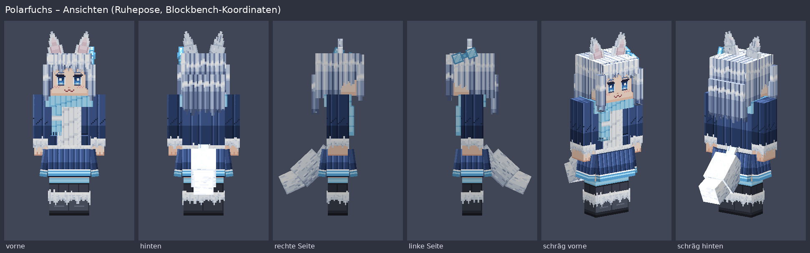
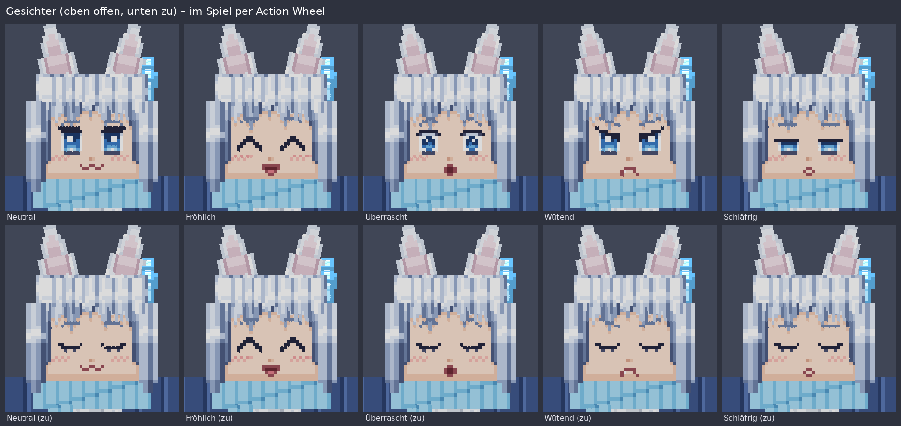

# Polarfuchs – hochauflösender Figura-Avatar (256×256)

Ein Polarfuchs-Mädchen im Minecraft-Look: Würfel-Körperteile, scharfe Pixel, aber mit einer
256×256-Textur, also 4×4 Texturpixeln pro Minecraft-Pixel. Funktioniert über **Figura**, denn
Vanilla-Minecraft akzeptiert nur 64×64-Skins.




**Inhalt**

- Anime-Stil, Slim-Arme (3 Pixel), eisblaue Augen, weiß-silbernes Haar
- Mantel mit Fellsaum, Pulli, Faltenrock, Strümpfe und Stiefel mit Fellstulpen
- 3D-Extras: Fuchsohren, dreiteiliger Schwanz, Pony, Seitensträhnen, Haare hinten, Rock (4 Bahnen),
  Schal mit losem Ende, Haarschleife
- Feder-Physik für Schwanz, Ohren, Haare, Schal und Rock; Wedeln im Stand, gelegentliches Ohrzucken
- Automatisches Blinzeln und 5 Ausdrücke (neutral, fröhlich, überrascht, wütend, schläfrig),
  umschaltbar über das Action Wheel und für andere Spieler synchronisiert
- Zweite Ebene (Haarschicht, Mantel, Ärmel, Stiefel-Fell) plus Accessoires einzeln abschaltbar

## Ordner

```
mein-avatar/
├─ avatar.json          Name, Beschreibung, Farbe
├─ model.bbmodel        Blockbench-Modell (generiert, Texturen eingebettet)
├─ skin.png             256×256 RGBA, Standard-Skin-Layout ×4
├─ extras.png           256×256 RGBA, Ohren/Schwanz/Haare/Rock/Schal/Schleife/Gesichter
├─ script.lua           Figura-Skript
├─ doku/                Vorschaubilder und UV-Übersicht (nur zur Ansicht)
└─ tools/               Generatoren (Python 3 + Pillow, kein Netzwerk)
   ├─ avatar_def.py       gemeinsame Geometrie und UV-Layout
   ├─ generate_texture.py Texturen + doku/uv_layout.png
   ├─ generate_model.py   model.bbmodel
   ├─ validate.py         Prüfungen
   └─ preview.py          Vorschaubilder in doku/
```

## Installation

1. Den Ordner Figura-Avatare deiner Minecraft-Instanz öffnen. Am einfachsten geht das in Figura
   selbst: Garderobe (Figura-Knopf im Pausenmenü) → Ordnersymbol „Avatar-Ordner öffnen“.
   Typische Pfade:
   - Offizieller Launcher: `%APPDATA%\.minecraft\figura\avatars`
   - Prism / MultiMC: `instances/<Instanz>/.minecraft/figura/avatars`
   - Modrinth App: `profiles/<Profil>/figura/avatars`
2. Einen Ordner `Polarfuchs` anlegen und **diese fünf Dateien** hineinkopieren:
   `avatar.json`, `model.bbmodel`, `skin.png`, `extras.png`, `script.lua`.
   `tools/` und `doku/` braucht Figura nicht. Sie würden nicht schaden, aber ohne sie bleibt der
   Ordner klein und eindeutig.
3. In der Garderobe den Avatar „Polarfuchs“ auswählen. Er ist dann sofort lokal aktiv.
4. Damit andere ihn sehen: in der Garderobe **hochladen** (Pfeil-nach-oben-Symbol).

**Action Wheel** (Standardtaste **B** gedrückt halten):

| Aktion | Wirkung |
|---|---|
| Ausdruck: Neutral … Schläfrig | Gesicht umschalten (» markiert den aktiven) |
| Helm anzeigen | Vanilla-Helm ein/aus (standardmäßig aus, weil die Ohren durchstechen würden) |
| Physik | Schwingen ein/aus |
| Ebenen & Accessoires … | Haarschicht, Mantel, Ärmel, Stiefel-Fell, Schal, Schleife, Rock einzeln schalten |

Die Einstellungen werden gespeichert (Figura `config`) und alle 10 Sekunden an andere Spieler
gesendet, damit auch später Dazugekommene den richtigen Ausdruck sehen.

## Anpassen

### Farben und Details per Skript (empfohlen)

Oben in `tools/generate_texture.py` stehen alle Parameter: Farbrampen für Haut, Haar, Fell,
Innenohr, Mantel, Pulli, Strümpfe, Stiefel, Akzent (Eisblau), Augen, Mund, Wangen, die Stärke
der Wangenröte je Ausdruck und `SEED` (anderer Wert = andere Strähnen- und Fellverteilung).
Augen, Brauen und Münder sind als kleine Pixelbilder (`EYES`, `BROWS`, `MOUTHS`) im Skript
definiert und lassen sich direkt umzeichnen.

Danach im Ordner `mein-avatar`:

```bash
pip install pillow numpy          # einmalig; optional: pyoxipng lupa
python3 tools/generate_texture.py # skin.png, extras.png, doku/uv_layout.png
python3 tools/generate_model.py   # model.bbmodel (bettet die neuen Texturen ein)
python3 tools/validate.py         # Prüfungen, Größe
python3 tools/preview.py          # doku/ansichten.png, posen.png, gesichter.png
```

Form und Lage der Teile (z. B. Schwanzlänge, Ohrgröße) stehen in `tools/avatar_def.py`.
Das Layout von `extras.png` wird dort automatisch verteilt.

### Von Hand in Blockbench oder einem Malprogramm

- `skin.png` folgt dem normalen Skin-Layout, nur ×4. Jede Vorlage für 64×64-Skins passt, wenn
  man sie auf 256×256 hochskaliert (Nearest-Neighbor). Die Beschriftung aller Flächen beider
  Texturen zeigt [doku/uv_layout.png](doku/uv_layout.png).
- Figura lädt die Texturen nach meinem Kenntnisstand **zuerst aus den PNG-Dateien neben dem Modell**
  (`relative_path`) und nur ersatzweise aus der eingebetteten Kopie. Bearbeitete PNGs wirken also
  nach einem Neuladen des Avatars im Spiel.
- Blockbench zeigt dagegen die in `model.bbmodel` eingebettete Kopie. Nach Änderungen an den PNGs
  `python3 tools/generate_model.py` ausführen, dann sieht Blockbench den neuen Stand. Malst du
  direkt in Blockbench, speichere die Textur dort (Rechtsklick → Speichern unter) wieder als
  `skin.png`/`extras.png`.
- Achtung: Wer `generate_texture.py` erneut ausführt, überschreibt Handarbeit an den PNGs.

### Skript-Einstellungen

Oben in `script.lua`: `PHYSIK_STAERKE`, Blinzel-Abstände, Sync-Intervall und `RICHTUNG`
(falls die Physik im Spiel spiegelverkehrt schwingt, `-1` eintragen).

## Technische Details und Annahmen

- **Zielumgebung:** Minecraft Java 1.21.11 mit Fabric. Das Skript nutzt nur die Figura-API 0.1.x
  (`vanilla_model`, `models`, `setVisible`, `setOffsetRot`, `getOriginRot`, `player:getVelocity`,
  `getBodyYaw`, `getRot`, `isCrouching`, `pings`, `config`, `action_wheel`, `events.tick/render`).
  Die gibt es seit Figura 0.1.0 unverändert. **NoFigura kenne ich nicht.** Ich gehe davon aus,
  dass es Figura-Avatare im üblichen Ordnerformat mit derselben API lädt. Falls NoFigura ein
  Fork mit abweichender API ist, sind die mit „PRÜFEN“ markierten Stellen im Skript die
  wahrscheinlichsten Kandidaten.
- **UV-Skalierung:** Projekt-UV 64×64 (`resolution`), jede Textur 256×256 mit
  `uv_width`/`uv_height` = 64. Blockbench (ab 4.9) und Figura rechnen damit jede UV-Einheit auf
  4 Texturpixel um. `validate.py` prüft das. `preview.py` rendert direkt aus `model.bbmodel`
  mit genau dieser Umrechnung, die Vorschaubilder sind also der Test, dass die UVs stimmen.
  Zusätzlich lädt der Avatar fehlerfrei im Figura-Nachbau von CubeCast (Blockbench-Parser und
  Lua-Laufzeit aus diesem Repo).
- **Blockbench-Format 4.10** („Generic Model“), Körperteile im Box-UV-Modus. Blockbench 5
  öffnet das ohne Weiteres. Das neue 5er-Format (Gruppen getrennt vom Gliederungsbaum)
  verstehen ältere Figura-Versionen eventuell nicht, deshalb bewusst das ältere.
- **Parent-Types:** `Head`, `Body`, `RightArm`, `LeftArm`, `RightLeg`, `LeftLeg`. Alle Extras haben
  deutsche Namen, die nicht mit Figura-Schlüsselwörtern beginnen (sonst würden sie doppelt
  mitbewegt).
- **Slim-Arme:** im Modell bündig an der Schulter (y 12–24, Pivot ±5/22/0) wie in Figuras
  Vorlage. Figura übernimmt die Vanilla-Armposition, bei Slim-Skins sitzen die Arme im Spiel
  daher 0,5 Pixel tiefer als in Blockbench.
- **Gesichter:** zehn flache Flächen knapp vor dem Kopf (5 Ausdrücke × offen/zu), immer genau eine
  sichtbar. Das braucht keine UV-Verschiebung per Skript und funktioniert damit in jeder
  Figura-Version.
- **Rüstung:** Helm aus (umschaltbar), Brustpanzer, Hose, Schuhe und Elytren bleiben Vanilla und
  liegen über dem Modell. Das Cape ist aus, weil es mit dem Schwanz kollidiert.

### Größe und Leistung (gemessen)

| | Wert |
|---|---|
| skin.png | 5.405 Bytes |
| extras.png | 4.886 Bytes |
| script.lua | 13.225 Bytes |
| model.bbmodel (mit eingebetteten Texturen) | 69.388 Bytes |
| **geschätzte Figura-Avatargröße** | **≈ 18 KB** von 100 KB (Standardlimit) |
| gezeichnete Flächen (alles sichtbar) | 202 |
| Lua-Instruktionen: Start / Tick (max.) / Bild (max.) | ≈ 1.400 / 960 / 270 |

Die PNGs sind verlustfrei mit oxipng optimiert und bleiben RGBA. Die Avatargröße ist eine
Schätzung (Texturen + komprimiertes Modell und Skript). Die genaue Zahl zeigt Figura in der
Garderobe beim Hochladen. Die Instruktionen wurden mit Lua 5.4 gezählt, Figura (LuaJ 5.2)
zählt ähnlich, aber nicht identisch.

## Bekannte Einschränkungen

- Andere Spieler sehen den Avatar nur, wenn sie **selbst Figura installiert** haben, deinen Avatar
  nicht blockiert haben und ihre Vertrauensstufe für dich ausreicht. Ohne Figura sehen sie deinen
  normalen Minecraft-Skin. Den solltest du separat setzen, z. B. eine 64×64-Version dieses Skins:
  `skin.png` mit Nearest-Neighbor auf 64×64 verkleinern. Gesicht und Extras fehlen dann natürlich.
- Steht deine Vertrauensstufe bei jemandem auf „niedrig“, kann Figura dort Skript-Instruktionen
  oder Komplexität begrenzen. Dann fehlen Physik und Ausdruckswechsel, das Modell bleibt
  sichtbar.
- Server oder Figura-Backends können ein anderes Größenlimit als 100 KB haben. Mit ≈ 18 KB ist
  viel Luft.
- Vanilla-Rüstung passt sich nicht an Ohren, Schwanz oder Rock an (Clipping möglich).
- Die Physik ist eine einfache Feder pro Gelenk, keine Kollision: Bei extremen Posen (Schwimmen,
  Elytra) kann der Schwanz durch Beine oder Rock gehen.

## Was nicht getestet werden konnte

In dieser Umgebung gibt es kein Minecraft und kein Blockbench. Getestet ist:
`validate.py` (JSON, Texturen, UVs, Überlappungen, Namen, Lua-Syntax, Größe), die Vorschaubilder
aus dem Software-Renderer, ein Lauf von 400 Ticks mit Laufen, Sprinten und Schleichen plus alle
Action-Wheel-Knöpfe in CubeCasts Figura-Nachbau (keine Fehler, Ausdrücke wechseln, Physik
bewegt sich) und eine Instruktionszählung.

**Nicht** getestet: echtes Figura in Minecraft 1.21.11, NoFigura, Blockbench selbst, die
Vorzeichen der Vanilla-Drehwerte (`getOriginRot`) und ob sie in Grad kommen, sowie das
Zusammenspiel mit Vanilla-Rüstung.

### Kurze Testliste im Spiel

1. Garderobe: Avatar erscheint ohne rote Fehlermeldung, Vorschau zeigt Gesicht, Ohren, Schwanz.
2. F5 (Third Person): Steht die Figur auf dem Boden? Liegen die Arme an den Schultern, sind links
   und rechts nicht vertauscht (Schleife sitzt auf der **linken** Kopfseite)?
3. Laufen und Sprinten: Schwanz hebt sich nach hinten, Haare und Schal wehen nach hinten,
   Rock öffnet sich mit den Schritten. Schwingt etwas verkehrt herum, `RICHTUNG = -1` setzen.
   Reagiert der Rock kaum, liefert `getOriginRot()` Bogenmaß statt Grad (bitte melden).
4. Stehen bleiben: leichtes Wedeln, alle paar Sekunden Blinzeln, ab und zu Ohrzucken.
5. Schleichen, Springen, Hinsetzen (Boot/Minecart), nach oben und unten schauen: Hängen die
   hinteren Haare natürlich, nichts verschwindet im Kopf?
6. Action Wheel (B): jeden Ausdruck, Helm, Physik und jede Ebene einmal schalten.
7. First Person: Der Arm ist schlank und eingefärbt (Mantelärmel mit Fellstulpe, Hand).
8. Rüstung und Elytra anziehen: Helm standardmäßig unsichtbar, Rest sichtbar.
9. Nach dem Hochladen: Zweitkonto oder Freund prüft, ob Ausdruck und Ebenen übereinstimmen.
10. Garderobe → Avatargröße ablesen (erwartet ≈ 18–25 KB).
